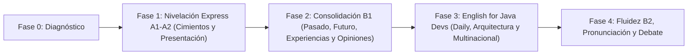

# 🗺️ Ruta de Aprendizaje Personalizada (`roadmap.md`)

**Estudiante**: Orus (Ingeniero de Sistemas / Java Developer en Multinacional)  
**Punto de Partida**: B1 Receptivo con lagunas en A1, A2 y B1 (especialmente en estructura rápida, vocabulario activo y pronunciación).  
**Meta**: Fluidez estructural, personal y profesional (B1 Sólido → B2 Operativo).

---

## Arquitectura de la Ruta (5 Fases Progresivas)

---

### 📍 Fase 0: Diagnóstico Integral (Actual)
- **Objetivo**: Detectar exactamente qué estructuras y qué tipo de vocabulario de A1, A2 y B1 presentan grietas.
- **Entregable**: Examen Diagnóstico en `practica/quices/01-examen-diagnostico.md` y mapa de brechas en `context/weaknesses-and-mistakes.md`.

---

### 🧱 Fase 1: Nivelación Express A1–A2 (Cerrar Huecos + Vida Personal)
*Enfocada en quitar lo "pausado y mal estructurado" en las frases de todos los días.*

- **Módulo 1.1 — Estructura Mental del Inglés y Presentación Impecable**:
  - **Gramática**: Orden innegociable `Subject + Verb + Object + Place + Time`, dominio sin titubeos de *To Be* vs. *Do/Does*, adverbios de frecuencia.
  - **Comunicación**: Cómo presentarte (quién eres, tu rol como Ingeniero/Java Dev, tu personalidad, dónde vives y cómo es tu ciudad/entorno).
  - **Pronunciación**: Sonidos clave que no existen en español (`ɪ` vs `iː`, la `s` líquida inicial en *Spring, SQL, status, schedule*, y la `ə` schwa).
- **Módulo 1.2 — Gustos, Rutina, Trabajo Diario y Conectores Base**:
  - **Gramática**: *Present Simple* vs *Present Continuous* (lo que haces habitualmente vs. en qué estás trabajando hoy en el Sprint), verbos de preferencia (*like, enjoy, keen on, looking forward to* + `-ing`).
  - **Vocabulario**: Huecos frecuentes de A1/A2 (objetos cotidianos, emociones, rasgos de personalidad, preposiciones de tiempo y lugar `in / on / at`).

---

### 🚀 Fase 2: Consolidación B1 (Tiempos, Experiencias, Ambiciones y Fluidez)
*Enfocada en contar historias, hablar de lo que hiciste ayer en el trabajo y proyectar tus ambiciones.*

- **Módulo 2.1 — Contar el Pasado sin Trabarse (Ayer en el Daily / Anécdotas)**:
  - **Gramática**: *Past Simple* vs *Past Continuous*, verbos irregulares de alta frecuencia (top 50 reales), pronunciación de terminaciones `-ed` (`/t/`, `/d/`, `/ɪd/` — vital para verbos como *deployed, fixed, updated, merged,needed*).
  - **Comunicación**: Explicar qué hiciste ayer, cómo resolviste un problema y contar experiencias personales.
- **Módulo 2.2 — Conectar el Pasado con el Presente (*Present Perfect*)**:
  - **Gramática**: *Have/Has + Past Participle*, diferencias entre *I did it* vs *I have done it*, uso de *already, yet, just, since, for*.
  - **Comunicación**: Hablar de logros profesionales, tecnologías que has usado (*"I've worked with Java and Spring Boot for X years"*) y metas alcanzadas.
- **Módulo 2.3 — Ambiciones, Planes y Condicionales**:
  - **Gramática**: *Going to* vs *Will* vs *Present Continuous for future*, *First & Second Conditional* (*"If we refactor this service, it will..."*), modales (*should, must, have to, might, could*).
  - **Comunicación**: Expresar ambiciones personales y profesionales, proponer soluciones y hablar de planes a mediano/largo plazo.

---

### 💻 Fase 3: Inglés de Alto Impacto para Java Developer en Multinacional
*Enfocada 100% en tu entorno laboral real.*

- **Módulo 3.1 — Daily Standups, Bloqueos y Updates**:
  - Estructuras listas para usar: qué hice, en qué estoy, qué me bloquea (*blockers*), pedir ayuda a otro equipo.
- **Módulo 3.2 — Explicar Código, Arquitectura, Bugs y Pull Requests**:
  - Vocabulario preciso de Ingeniería de Software y ecosistema Java (*threads, memory leaks, endpoints, payloads, latency, refactoring, backwards compatibility, edge cases, trade-offs*).
- **Módulo 3.3 — Reuniones, Opiniones y Negociación de Tiempos**:
  - Cómo estar de acuerdo o en desacuerdo con cortesía, pedir aclaraciones cuando no entiendes a un compañero nativo/indio/europeo, y estimar esfuerzos.

---

### 🎙️ Fase 4: Fluidez Natural, Phrasal Verbs y Ritmo (B1+ → B2)
- **Módulo 4.1 — Phrasal Verbs Esenciales (Trabajo y Vida Diaria)**:
  - *Figure out, look into, point out, bring up, run into, set up, roll back, catch up, put off, carry on*.
- **Módulo 4.2 — Connected Speech y Reducción de Pausas**:
  - *Fillers* naturales (*Well, actually, what I mean is, let me think, basically*) para ganar tiempo al hablar sin quedarte en silencio ni sonar robótico.
